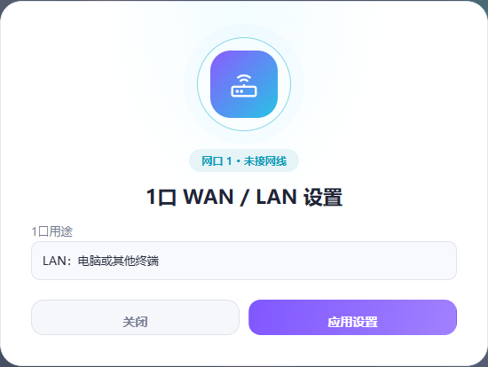

# NRadio C2000 Ultra 固件维护

面向**NRadio-C2000MAX-Ultra / C2000Ultra**的ImmortalWrt自编适配项目，维护Ultra板级适配、联发科闭源Wi-Fi驱动、QModem、巴龙WebUI与运行资源管理。

| 项目 | 当前版本 |
| --- | --- |
| 系统 | ImmortalWrt25.12-SNAPSHOT |
| 内核 | Linux6.12.103 |
| 无线 | 联发科闭源驱动8.3.1.2 |
| 巴龙WebUI | 上游v3.0.2，QModem适配包3.0.2-r2 |
| 完整固件 | ultra-25.12-20261023-r9 |
| 升级包 | ultra-maintenance-20261023-2 |
| 固件格式 | sysupgrade，布局兼容号2.0，根分区内预留512MiB |

## 下载

| 下载 | 用途 |
| --- | --- |
| [维护升级包](https://github.com/YakumoRyu/nradio-c2000-ultra-firmware/releases/tag/ultra-maintenance-20261023-2) | 在r4/r5/r6/r7/r8基线上安装17文件累计修复，保留配置。r8仅更新两个媒体保护文件。 |
| [完整r9固件](https://github.com/YakumoRyu/nradio-c2000-ultra-firmware/releases/tag/ultra-25.12-20261023-r9) | 内核和完整根文件系统，全部通用修复编入ROM。配套离线软件仓库在同一Release下载。 |

本次修复媒体保护查询超时、停服后恢复和重启状态保存，并调整Emby内存回收水位。实机媒体库、内外网视频分段读取及3分钟持续监测通过；完整r9为整镜像待实机启动的预发布版本。

完整固件约206MiB，可选软件仓库约144MiB，内置Docker、Mihomo、Cloudflared、Python和原有管理组件。

- [升级包安装与回退](releases/ultra-maintenance-20261023-2/README.md)
- [完整固件安装](docs/INSTALL.md)
- [更新日志](CHANGELOG.md)
- [源码与构建](docs/BUILD.md)
- [维护流程](docs/MAINTENANCE.md)
- [项目记忆](docs/PROJECT_MEMORY.md)

## 已集成的改动

- **媒体资源保护**：Docker超时继续监测，分步恢复、跨重启保存保护目标，Emby采用320MiB回收水位及384MiB硬限制，保留后台追赶分析。
- **号码与短信**：正确解析SIM号码，短信管理统一到巴龙WebUI，保留PushPlus和QModem后台。
- **系统切换**：按钮独立于旧配置节，POST/CSRF校验；LTE SINR补读采用正确字段顺序。[1150对比](docs/MWRT1150_COMPARISON.md)。

- **无线DMA恢复**：异常RX描述符通过厂商SER队列请求恢复，增加DMA读屏障，保留NAPI无进展退出修复。

- **运营商图标**：4家运营商资源完整，图片解码后显示，失败隐藏，状态轮询不重复加载。

- **CPU与首页优化**：减少分钟自愈检查创建的进程，使用共享非阻塞CPU采样和原生状态读取，修复旧PCDN接口JSON报错。

- **网口1切换WAN/LAN**：支持DHCP、PPPoE和静态IPv4；上级网关接入提示；90秒确认与自动回退。
- **新版网口弹窗**：居中卡片、模糊背景、渐变图标、简洁信息行和紫色操作按钮，适配桌面与手机。
- **模组字段修复**：分离AT应答与异步流量上报，校验IMEI，清理首页和设备接口缓存中的异常值。
- **侧栏型号显示**：完整显示C2000Ultra，按词换行。
- Wi-Fi NAPI空转、QoS事件边界与逐设备接收计数修复。
- Ultra板型、TF启动与升级布局适配，原登录页面保持。
- QModem统一负责模块发现、拨号和AT串口，巴龙WebUI通过ubus调用。
- QModem有效PDP应答清零异常计数，连续4次异常触发恢复拨号。
- 短信管理和转发共用持久数据库；Web查看保持已读位与转发任务，删除使用独立数据库编号。
- PushPlus通用转发脚本和自定义转发入口。
- UPnP/IPv6、设备速率统计、代理恢复及媒体资源管理。
- 1GiB zram、zstd6级默认值，路由业务优先。

网口1默认属于LAN，网口2保留LAN；有线WAN的IPv4 metric为50，5G保持现有主出口设置。接入提示由用户选择是否应用。



## 出厂配置与分享

公开镜像采用通用配置，不含个人密码、SSH身份、订阅、域名、PushPlus/Cloudflare凭据或短信/媒体数据。无线校准由每台设备的Factory分区生成。

恢复出厂后保留ROM中的程序与修复，并清理可写区的个人配置和应用数据。恢复后重新设置网络、密码与服务。

## 项目结构

```text
configs/           编译配置
patches/           基线和QModem补丁
source-additions/  Ultra DTS、驱动及内核补丁
overlay/           通用只读系统脚本与管理资源
packages/          WebUI、网口管理与兼容软件包
webui/             React/TypeScript前端源码
scripts/           可回退的维护升级工具
tests/             协议、事务和升级回归
releases/          版本说明与验收记录
sources.lock.json  上游来源和固定提交
```

完整构建还使用`binary-assets.lock.json`列出的大型二进制输入，准备步骤见[构建说明](docs/BUILD.md)。

## 反馈与迭代

在[Issues](https://github.com/YakumoRyu/nradio-c2000-ultra-firmware/issues)提供型号、版本、触发步骤和脱敏日志。迭代流程为复现、修复、回归、隐私检查、发布和实机验收。

## 上游与许可

感谢[ImmortalWrt](https://github.com/immortalwrt/immortalwrt)、[chasey-dev](https://github.com/chasey-dev/immortalwrt-mt798x-rebase)、[QModem](https://github.com/FUjr/QModem)、[MT5700 WebUI](https://github.com/inotdream/mt5700webui-openwrt-server)和[iStore](https://github.com/linkease/istore)。各组件沿用其原有许可，见[THIRD_PARTY_NOTICES.md](THIRD_PARTY_NOTICES.md)与`LICENSES/`。
